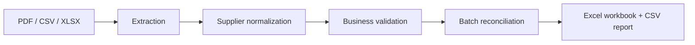

# Automated Invoice Processing & Reconciliation

A completed portfolio implementation of a local, configurable invoice workflow. It reads batches of CSV, XLSX, and known-layout digital PDFs; extracts and checks invoice data; compares records across files; and produces an Excel review workbook plus a per-file CSV report. The included demo uses only synthetic data.

## The business problem

Processing supplier invoices by hand often means copying fields between documents and spreadsheets, checking arithmetic, looking for repeat invoices, and assembling a status report. Different input formats and supplier names make that work harder to review consistently. This project demonstrates a repeatable batch workflow with traceable errors and explicit review flags. It does not make payment or approval decisions.

## The solution



Place files under `input/` and run `python main.py`. The program discovers regular files in stable relative-path order, dispatches supported extensions, retains row-level parse errors, and continues when one file fails. Business validation runs on each extracted invoice; duplicate, possible-duplicate, and outlier checks run across the full batch. Final file statuses include reconciliation findings. Original inputs are never modified.

## Key features

- CSV, XLSX, and machine-readable PDF extraction for explicitly configured layouts.
- Configurable supplier aliases, PDF profiles, currencies, tolerances, and outlier rules.
- `Decimal` money handling and field-level errors for rows that cannot be converted.
- Required-field, currency, due-date, and arithmetic validation.
- Exact duplicates across files and formats; date-and-amount-based possible duplicates; high-total outliers.
- A resilient batch: supported corrupt files become `FAILED`, unknown extensions become `UNSUPPORTED`, and other files continue.
- A four-sheet Excel workbook and a UTF-8-with-BOM processing report.
- Fixed-seed synthetic demo, machine-readable scenario manifest, and deterministic tests.

## Demo results

The checked-in demo generated **40 extracted invoices** from **10 discovered files**: 3 CSV files, 2 XLSX files, 4 PDF files (one intentionally corrupt), and 1 unsupported TXT file. The 40 invoices came from 22 CSV rows, 15 XLSX rows, and 3 readable PDFs. One additional CSV row intentionally fails conversion and is not counted as an invoice.

| File status | Count | Invoice status | Count |
| --- | ---: | --- | ---: |
| `SUCCESS` | 4 | `VALID` | 25 |
| `REVIEW` | 3 | `REVIEW` | 15 |
| `PARTIAL` | 1 | | |
| `FAILED` | 1 | | |
| `UNSUPPORTED` | 1 | | |

The reports contain **18 findings**:

| Issue type | Count | Issue type | Count |
| --- | ---: | --- | ---: |
| `DUPLICATE` | 4 | `POSSIBLE_DUPLICATE` | 4 |
| `MISSING_FIELD` | 2 | `PARSE_ERROR` | 3 |
| `AMOUNT_MISMATCH` | 1 | `INVALID_DATE` | 1 |
| `INVALID_CURRENCY` | 1 | `UNKNOWN_SUPPLIER` | 1 |
| `OUTLIER` | 1 | | |

Amounts remain in their own currencies. Totals include all constructed invoices, including `REVIEW` and duplicate records, because this workflow flags records without deleting or correcting them.

| Currency | Invoices | Total amount |
| --- | ---: | ---: |
| CAD (invalid currency example) | 1 | 250.00 |
| EUR | 24 | 43,244.81 |
| GBP | 7 | 19,836.00 |
| USD | 8 | 20,563.01 |

No cross-currency grand total is calculated. All **19 named scenarios** in [`sample_data/expected_scenarios.yaml`](sample_data/expected_scenarios.yaml) were verified, including two cross-format duplicate groups, two possible-duplicate pairs, an outlier, business rule violations, a row parse error, a corrupt PDF, and an unsupported file.

## Output

`output/invoice_master.xlsx` (normal run) or `demo_output/invoice_master.xlsx` (demo) contains:

| Sheet | Purpose |
| --- | --- |
| **Invoices** | One row per constructed invoice with raw and normalized supplier, dates, currency, numeric amounts, source identity, final `VALID`/`REVIEW` status, and invoice-level issue count. |
| **Issues** | Business and reconciliation issues, row parse errors with field/raw value, and file-level failures. |
| **Suppliers** | Counts and totals grouped by supplier **and currency**; missing totals add zero while the invoice remains counted. |
| **Summary** | File, invoice, and issue KPIs; currency and monthly totals; supplier ranking within currency; and a chart of invoice counts by status. |

`output/processing_report.csv` (or `demo_output/processing_report.csv`) has one row per discovered file: relative filename, final status, invoice count, ordered invoice numbers, issue count, and a short error message when relevant. It is comma-delimited UTF-8 with BOM for Excel compatibility.

`SUCCESS` means invoices were extracted without row errors and all finished `VALID`. `REVIEW` means extraction completed but at least one invoice finished `REVIEW`. `PARTIAL` means at least one invoice was extracted alongside row failures or a later extraction error; it takes precedence over `REVIEW`. `FAILED` means a supported file yielded no usable invoice. `UNSUPPORTED` means the extension was not recognized. `main.py` exits 0 when both reports are written, even if some file or invoice statuses need attention; fatal configuration or output errors return nonzero.

Issue counts use one policy: Invoices counts business and reconciliation issues attached to each record; Suppliers sums those invoice counts; file reports count business, reconciliation, row parse, and file-level issues for the file. Parse errors for rows that yielded no invoice do not inflate invoice or supplier counts.

## Example issues detected

- `NS-DUP-1` appears in a CSV and an XLSX and receives `DUPLICATE` on both records.
- `NS-PDF-1` appears in a CSV and a digital PDF and forms a second duplicate group.
- `NS-POSS-1` and `NS-POSS-2` have close dates and totals but distinct numbers, so both receive `POSSIBLE_DUPLICATE`.
- `CL-OUTLIER` exceeds both configured high-total thresholds relative to other Cedarline EUR invoices and requires review.
- A CSV amount of `not-a-number` becomes a field-level `PARSE_ERROR`; a corrupt PDF becomes `FAILED` without stopping the batch.

Possible duplicates and outliers are heuristics for human review. None of these labels implies fraud.

## Configuration

- [`config/rules.yaml`](config/rules.yaml): required fields, allowed currencies, arithmetic tolerances, possible-duplicate window, outlier thresholds, tabular aliases, and number/date formats.
- [`config/suppliers.yaml`](config/suppliers.yaml): fictional canonical suppliers and exact aliases after safe case and whitespace normalization.
- [`config/pdf_profiles.yaml`](config/pdf_profiles.yaml): markers and regular expressions for two known digital PDF layouts.

Configuration is loaded with `yaml.safe_load` and validated before processing. Invoice numbers remain text. Money is not converted between currencies. No input values are silently corrected. Untrusted strings that might be interpreted as spreadsheet formulas are written as literal text. Each output is written to a temporary file in its destination directory and replaces the prior version only after successful generation.

## Run locally

Use Python 3.11 or newer from the project root:

```text
python -m pip install -r requirements.txt
python main.py
```

Create `input/csv/`, `input/excel/`, and `input/pdf/` if they are absent, then place files there. Nested input paths are allowed. The dispatcher uses the extension, not content guessing. Symbolic links are skipped; `output/` is never scanned. An empty `input/` still produces valid reports with zero invoices. A normal run uses only `input/` and `output/`.

## Run the demo

```text
python scripts/generate_sample_data.py
python scripts/run_demo.py
```

The generator uses seed `20260928`, writes the synthetic batch under `sample_data/demo_input/`, and refuses to ignore unexpected files in that directory. The demo runner reads that directory directly, checks the scenario manifest and report contents, verifies input hashes, and writes official reports to `demo_output/`. It does not touch personal files under `input/` or normal `output/`. Re-running the generator gives the same logical invoices and findings; internal XLSX/PDF metadata may differ byte-for-byte.

Three portfolio images based on the official demo outputs are included under `docs/portfolio/`. To regenerate them, run `python scripts/create_portfolio_visuals.py` after the demo; that optional script uses Matplotlib, which is **not** needed to run or test the invoice processor.

## Tests

```text
python -m pytest -q
```

Final audit result: **234 passed, 1 skipped** (0 failed). The suite covers extraction, normalization, validation, reconciliation, discovery, reporting, safe output replacement, the generator, and the scenario manifest. The symbolic-link test was skipped on this Windows host because symlink creation was unavailable.

## Project structure

```text
config/                  Rules, suppliers, and known PDF profiles
src/invoice_processing/  Discovery, extractors, validation, reconciliation, reporting
scripts/                 Synthetic data generator, demo verifier, optional visuals
sample_data/demo_input/  Synthetic CSV, XLSX, PDF, and unsupported fixtures
sample_data/expected_scenarios.yaml
demo_output/             Official demo workbook and processing report
docs/portfolio/          Three data-based PNGs
docs/                    Portfolio case study and listing metadata
input/                   User batch directory (not the demo store)
output/                  Reports from normal main.py runs
tests/                   Automated regression suite
main.py                  Normal batch entry point
```

## Design decisions and limitations

`Decimal` avoids binary floating-point comparisons for money. PDF extraction uses explicit profiles because arbitrary invoice layouts cannot be parsed reliably by these rules. Duplicate identity is normalized supplier plus textual invoice number; the first record in stable batch order is the reference. All members are flagged, not merged. Positive outliers are evaluated only with enough other same-supplier, same-currency invoices and must exceed both thresholds. Review flags do not change monetary values.

Only machine-readable PDFs matching a configured profile are supported. There is no OCR, universal invoice understanding, currency conversion, accounting integration, payment execution, or automatic approval. Heuristics require a person to review the source documents and business context. This is a portfolio case study with wholly synthetic organizations and invoices; it is not a claim of a client deployment or measured business savings.

Licensed under the [MIT License](LICENSE).
